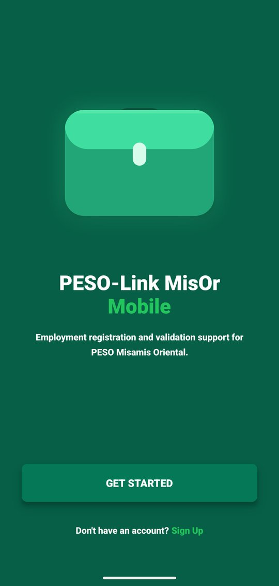
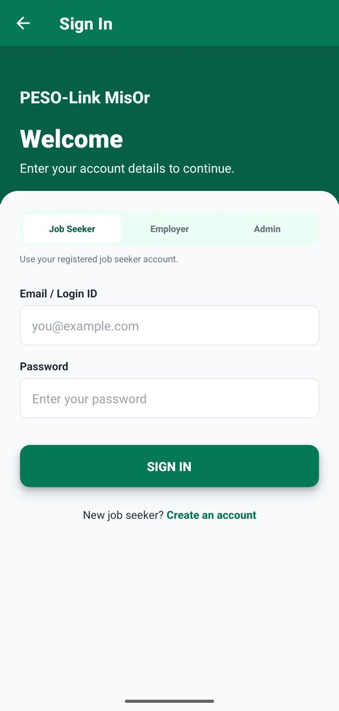
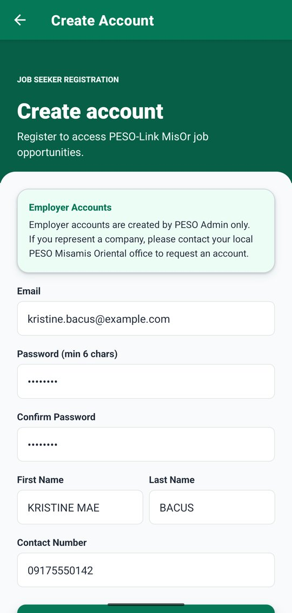
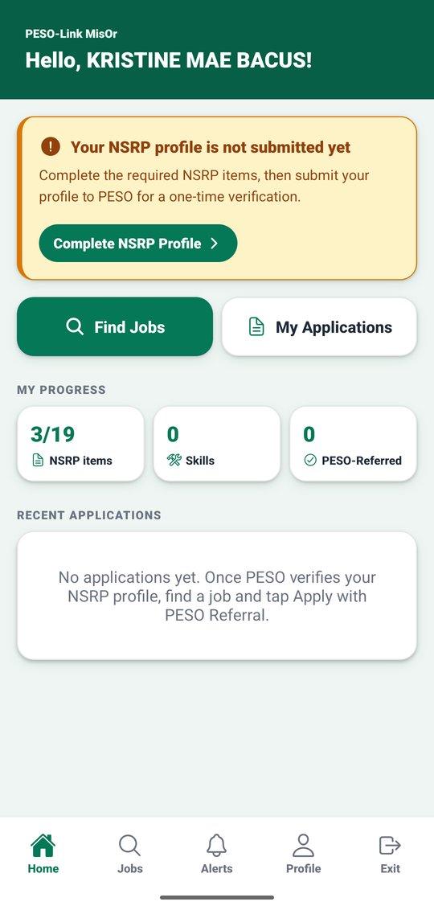

# 1. Getting started

[Back to contents](README.md)

## What you need

- An **Android phone**. The app is not available for iPhone.
- An **internet connection** (mobile data or Wi-Fi). The app needs it to sign in, save, and load anything.
- The app's **APK file**. An APK is the installer file of an Android app, given by the PESO-Link team (for example, by message or a shared link). If the app is later published on **Google Play**, install it from the Play Store instead and skip section 1.1.

## 1.1 Install the app

1. Open the APK file you received. It is usually in the phone's **Files** or **Downloads** app, or you can tap it in the message where you received it.
2. If Android says installing from this source is not allowed, tap **Settings**, turn on **Allow from this source**, then go back.
3. Tap **Install**. If a "Play Protect" or "unsafe app" warning appears, tap **More details**, then **Install anyway**. (This warning appears for apps that do not come from the Play Store.)
4. When it finishes, tap **Open**. Next time, open **PESO-Link MisOr** from your phone's app list.

The exact words of these steps can differ a little between phone brands.

## 1.2 Sign in

 

1. On the welcome screen, tap **GET STARTED**.
2. Choose your role first by tapping one of the three buttons at the top of the form: **Job Seeker**, **Employer**, or **Admin**. The chosen one turns white. The sign-in only works with the right role.
3. Type your **Email / Login ID** and **Password**.
4. Tap **SIGN IN**.

- Employer and PESO Admin accounts are given by PESO. Employers cannot create their own account in the app.
- The app has no "forgot password" option. If you cannot sign in, contact PESO.

## 1.3 Create a job seeker account

 

1. On the sign-in screen, tap **New job seeker? Create an account** (or **Sign Up** on the welcome screen).
2. Tap each box and type:
   - **Email**: an email address you use. It becomes your login. The app does not send emails to it.
   - **Password** (at least 6 characters) and **Confirm Password** (type it again). Remember it: the app has no "forgot password" option.
   - **First Name**, **Last Name**, and **Contact Number** (for example 09171234567).
3. Tap **CREATE ACCOUNT**. If something is wrong (for example, the email is already used), the app tells you what to fix.
4. The app opens your **Home** screen. The amber card says your NSRP profile is not submitted yet. Continue with the [Job seeker guide](2-job-seeker.md).

## 1.4 Moving around the app

Each role has **tabs** at the bottom of the screen. Tap a tab to open that part of the app. Many screens are longer than the phone screen: **scroll down** (slide your finger up) to see the rest and find the buttons at the bottom.

| Role | Tabs |
|---|---|
| Job seeker | Home, Jobs, Alerts, Profile, Exit |
| Employer | Home, Jobs, Applicants, Alerts, Exit |
| PESO Admin | Home, NSRP, Referrals, Alerts, Exit |

- The **Home** screen shows what needs your attention, the number of new alerts, your main actions, and a short summary.
- A red number on **Alerts** shows how many alerts you have not read yet.
- Tap **Exit**, then **Sign Out**, to sign out.

[Next: Job seeker guide](2-job-seeker.md)
