# 2. Job seeker guide

[Back to contents](README.md)

## Before you start

Have these ready:
- your personal details: full name, date of birth, place of birth, address, contact number, and email
- your education, any training, eligibility or license, and work experience (if any)
- your government ID numbers if you have them (TIN, GSIS/SSS, Pag-IBIG, PhilHealth); leave them blank if you have none
- optional: your filled-in paper **NSRP Form 1**, if you want to use the form scan

You do not have to finish in one go. Tap **SAVE PROFILE** to keep your progress and continue later.

## The steps

The usual order is:

1. Fill in your NSRP profile (by typing, or with the optional form scan).
2. Choose your skills and save.
3. Submit your profile to PESO.
4. Wait for PESO to verify it (once).
5. Find a job and apply with PESO referral.
6. Track your applications and alerts.

## 2.1 Fill in your NSRP profile

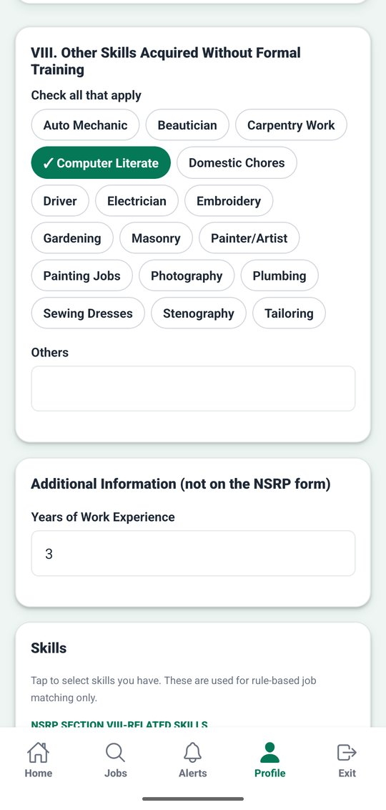 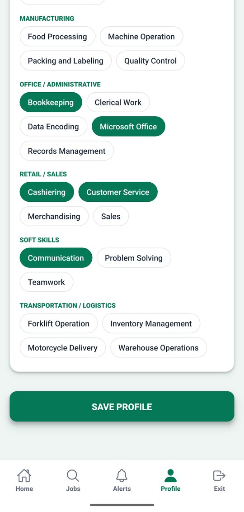

1. Tap the **Profile** tab (or **Complete NSRP Profile** on Home).
2. Fill in the form. It follows NSRP Form 1 (DOLE, January 2017), sections I to VIII: personal information, job preference, language, education, training, eligibility and license, work experience, and other skills.
   - **Text boxes:** tap the box and type.
   - **Choices** (for example Sex, Civil Status, Yes/No): tap your answer. It turns green with a check mark (✓).
   - To see which items are still required, look at the **Required NSRP items** card at the top (step 3 below). Not every required item has a **\*** mark.
   - Type the date of birth as **mm/dd/yyyy** (for example 03/14/1999).
   - Your answers are saved in capital letters, like the paper form's block letters.
   - Where the paper form says to write "NA", leave the item blank.
3. The **Required NSRP items** card at the top shows how many of the 19 required items are filled in and lists the missing ones.
4. Scroll to the bottom and tap **SAVE PROFILE** to keep your answers. You can come back and continue at any time.
5. You can also fill in the form from a photo of your paper NSRP form. See [2.2 Optional: fill in the form by scanning it](#22-optional-fill-in-the-form-by-scanning-it).

## 2.2 Optional: fill in the form by scanning it

The scan (OCR) reads a photo of your filled-in NSRP Form 1 and puts the answers into the fields. It only saves typing: **you must check every field before saving.**

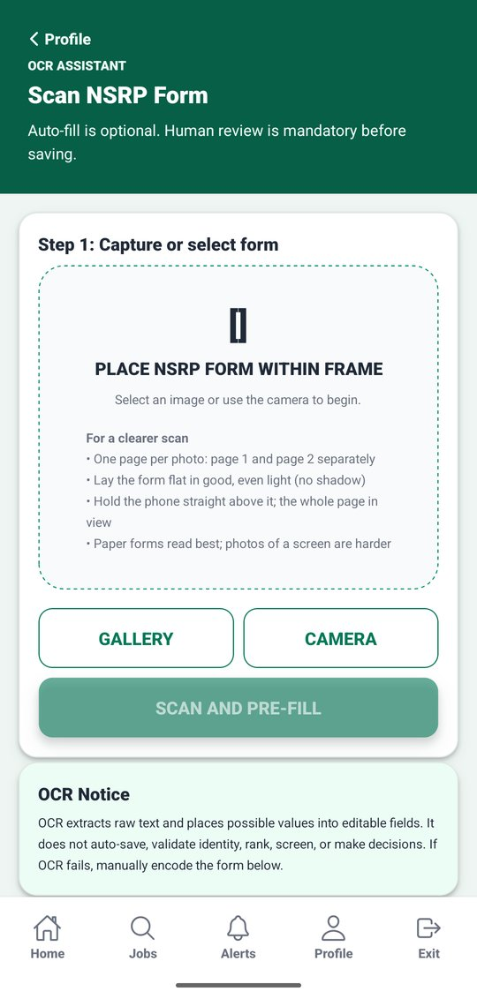 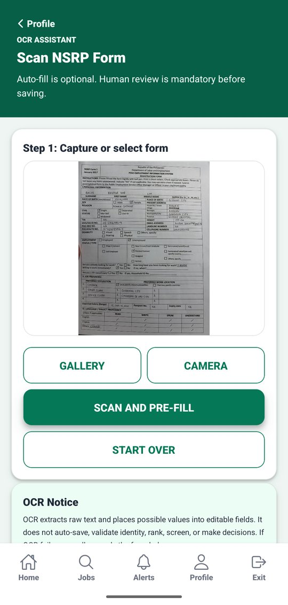

1. On **Profile**, tap **Fill from a scanned NSRP form (OCR Assistant, optional)**. The **Scan NSRP Form** screen opens.
2. Tap **GALLERY** to pick a photo, or **CAMERA** to take one. Use **one page per photo** (page 1 and page 2 separately).
   - Lay the form flat in good, even light, with the whole page in view.
   - Paper forms read best; photos of a screen are harder.
3. Tap **SCAN AND PRE-FILL** and wait. Reading a photo can take up to about a minute. When it is done, the app shows "OCR Complete"; tap **OK**.

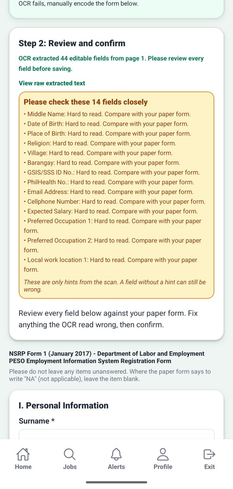 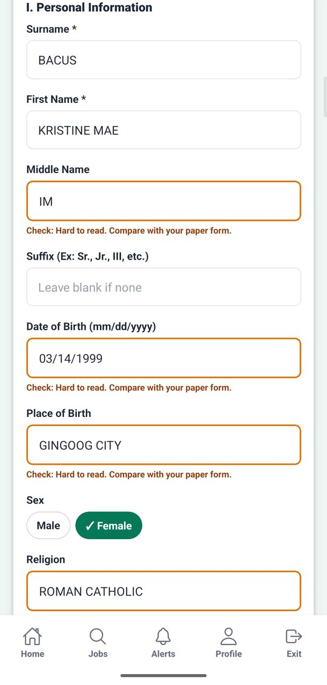

4. Scroll down past the photo to **Step 2: Review and confirm**. The amber box lists the fields the scan found hard to read, and each of those fields has a **Check:** note under it.
5. Compare **every** field with your paper form and fix anything that is wrong. A field without a note can still be wrong.
6. To add page 2, pick its photo and scan it the same way (you can do this before or after confirming page 1). Answers from both pages are kept; scanning one page does not erase the other.

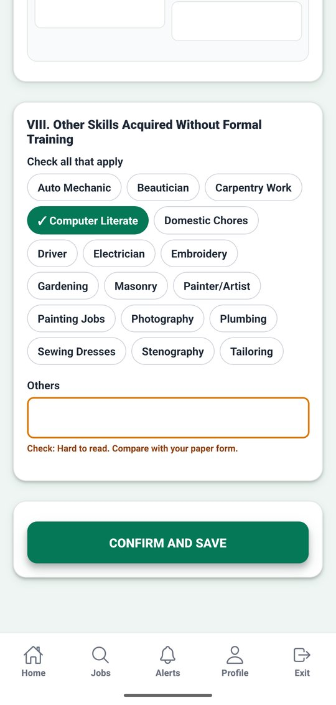

7. Scroll to the bottom and tap **CONFIRM AND SAVE**. Only now are the answers saved to your profile. The profile is **not** sent to PESO yet.

- If the photo is not an NSRP form page, the app says so and fills in nothing.
- Your form photos are kept with your profile so PESO can compare them during verification.

## 2.3 Choose your skills and save

 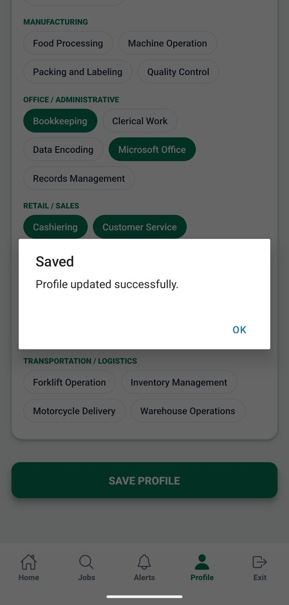

1. On **Profile**, scroll to **Skills** and tap each skill you have. Skills related to NSRP Section VIII are listed first.
2. Tap **SAVE PROFILE**. The app shows "Profile updated successfully."

The skills you pick here are the ones compared with each job's required skills. The Section VIII checkboxes of the form are part of your NSRP profile, but only the skills picked from this list are used in the skill comparison.

## 2.4 Submit your profile to PESO

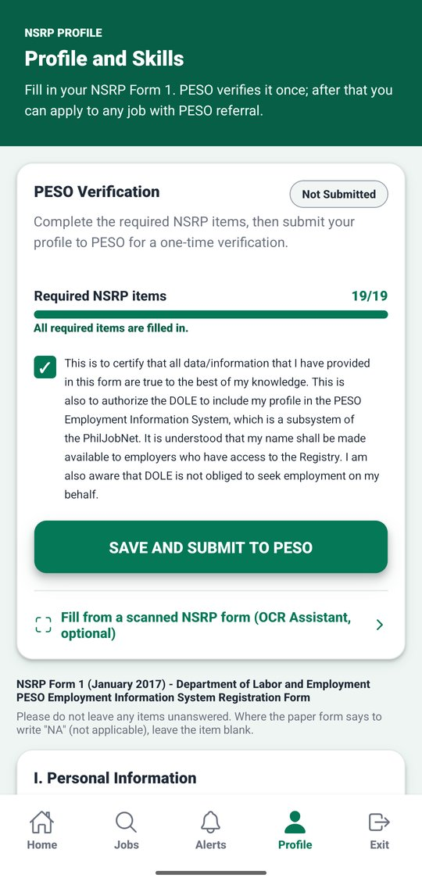 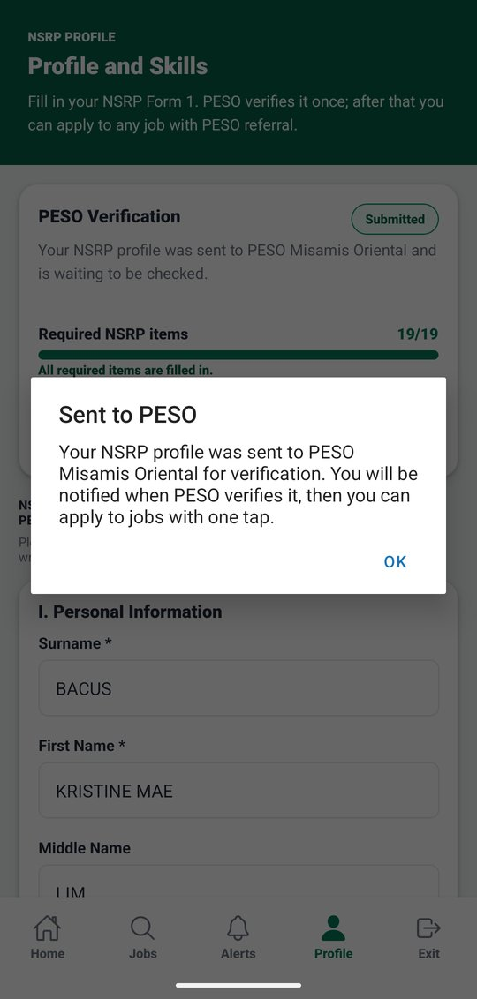 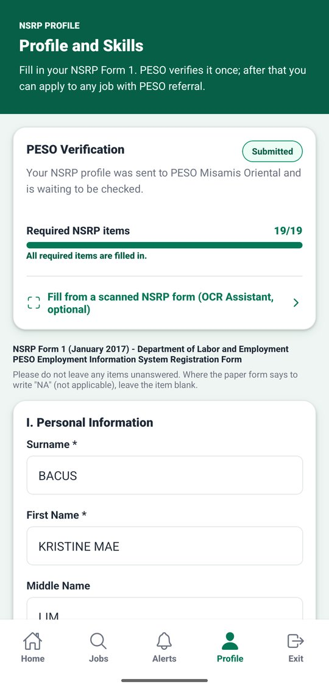

1. When all 19 required items are filled in (the card shows **19/19**), read the **certification** text at the top of **Profile** and tick its box. It replaces the signature on the paper form.
2. Tap **SAVE AND SUBMIT TO PESO**. The app shows "Sent to PESO".
   - The button stays grey until all 19 items are filled in and the box is ticked. If it is grey, check the list of missing items on the card.
3. Your status changes to **Submitted**. PESO checks it once.

| Status | Meaning |
|---|---|
| Not Submitted | Not yet sent to PESO |
| Submitted | Waiting for PESO |
| For Review | PESO has opened your profile |
| PESO-Verified | PESO verified your profile; you can apply to jobs |
| Needs Revision | PESO returned it with a note; fix it and submit again |

### If PESO returns your profile

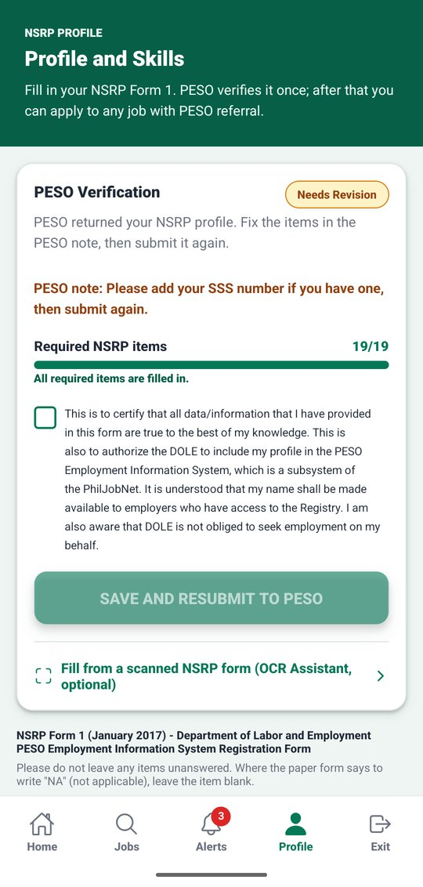

1. Your status shows **Needs Revision**, with the **PESO note** saying what to fix. You also get an alert.
2. Fix the items, tick the certification again, and tap **SAVE AND RESUBMIT TO PESO**.

### When PESO verifies your profile

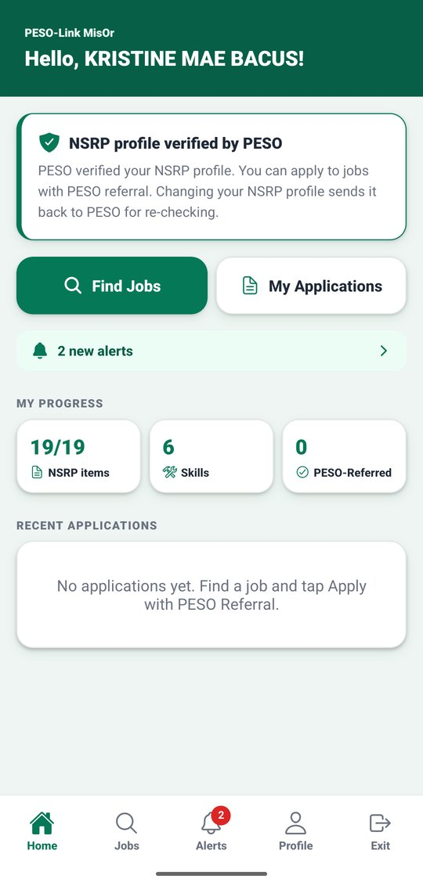 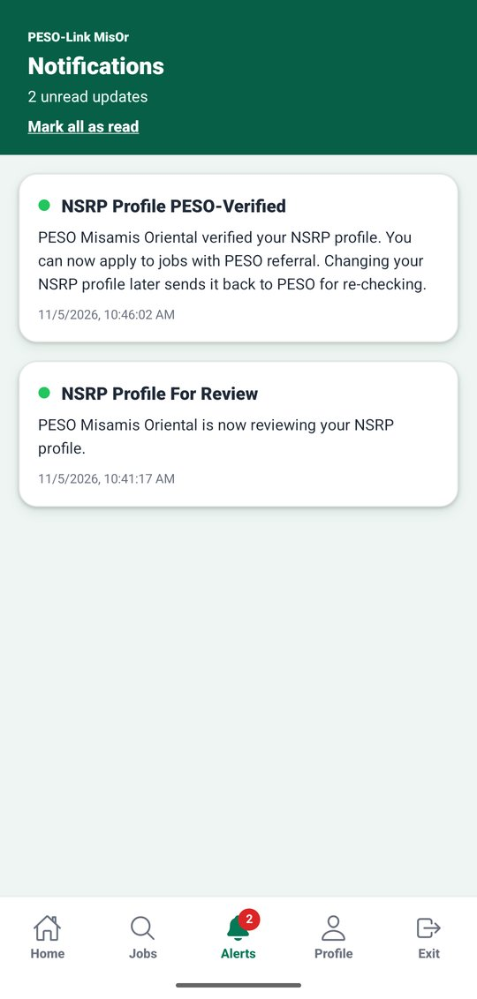

Home shows **NSRP profile verified by PESO**, and you get a **NSRP Profile PESO-Verified** alert. You can now apply to any job with PESO referral.

### If you change a verified profile

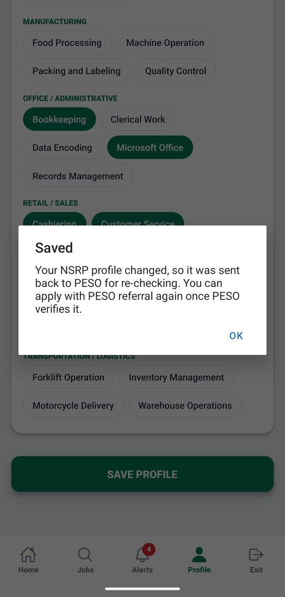

Saving a change to your NSRP profile or skills sends it back to PESO for re-checking. Until PESO verifies it again, you cannot apply to new jobs.

## 2.5 Find a job

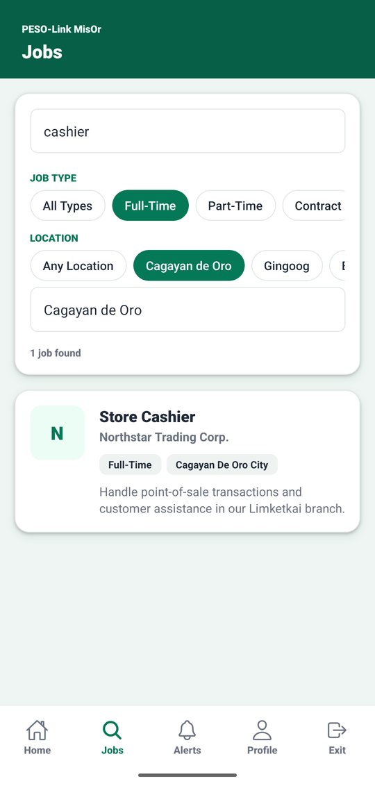 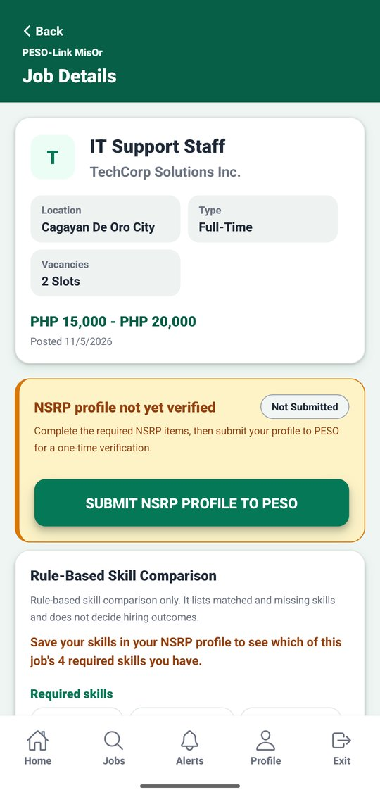

1. Tap the **Jobs** tab (or **Find Jobs** on Home).
2. Search by job title, company, or keyword, and filter by **job type** and **location**.
3. Tap a job to see its details: location, type, vacancies, salary, description, requirements and application instructions, employer details, and the skill comparison.
   - Some employers also give an **Application Email** for applying directly. Direct applications are handled outside the app and are not tracked.

## 2.6 Apply with PESO referral

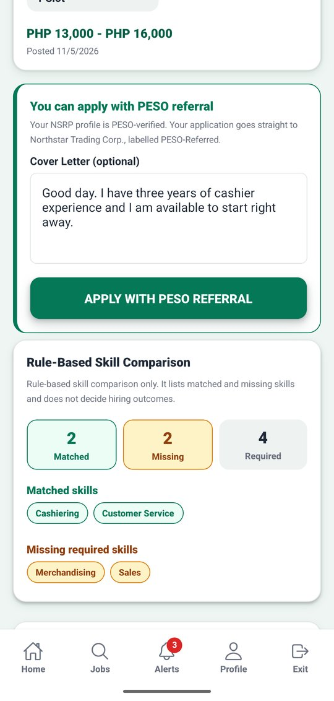 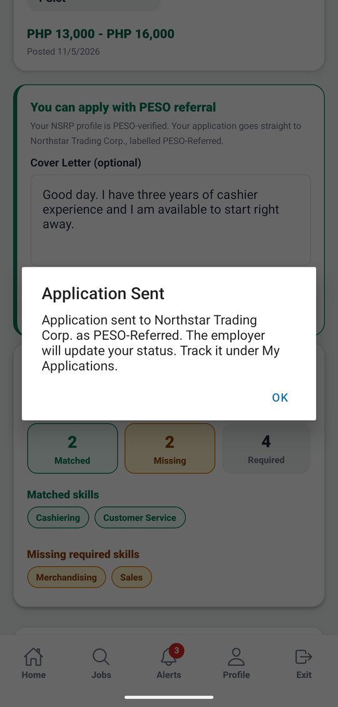

1. Open the job. If your profile is PESO-Verified, the job shows **You can apply with PESO referral**.
2. Check the **Rule-Based Skill Comparison**: your matched skills and the job's missing required skills.
3. Optionally write a **Cover Letter**.
4. Tap **APPLY WITH PESO REFERRAL**. The app shows "Application Sent". The employer receives your application as PESO-Referred.
5. Now wait for the employer. You get an alert each time they update your status (for example, For Interview), and you can follow it in **My Applications**. The employer contacts you outside the app for the interview, using the contact details in your profile.

- If your profile is not verified yet, the job shows your status instead of the Apply button.
- If a minimum number of matching skills is set, the job page tells you how many more matching skills you need, with an **Update My Skills** button.
- You can apply to each job once.

## 2.7 Track your applications

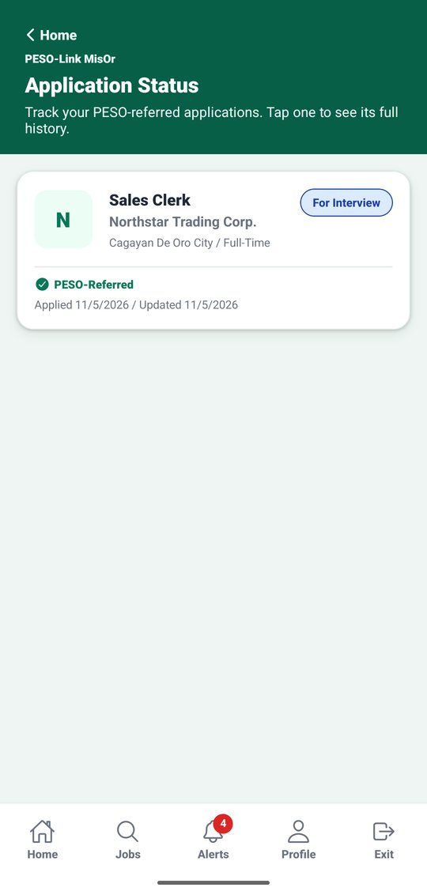 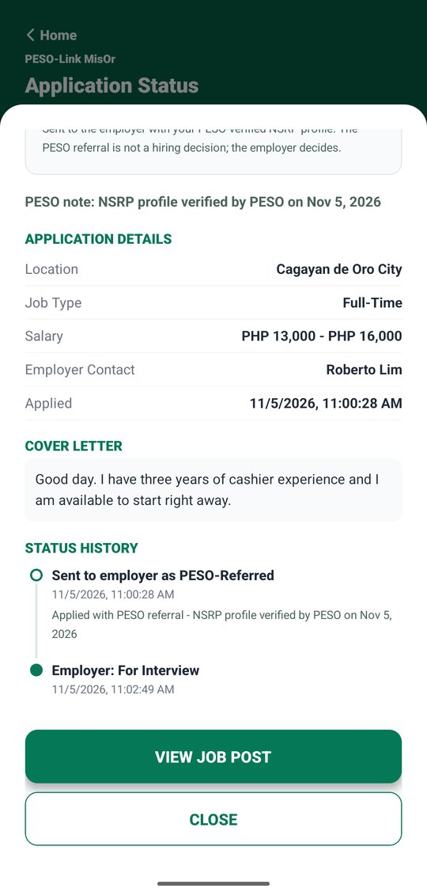

1. Tap **My Applications** on Home.
2. Tap an application to see its progress, details, cover letter, and **Status History**.

| Application status | Meaning |
|---|---|
| For Review | The employer has your application |
| For Interview | The employer wants to interview you |
| Hired | The employer hired you |
| Rejected | The employer did not choose you for this job |
| Closed | The job post was closed (or an account was deactivated). **This is not a rejection.** |

## 2.8 Alerts

 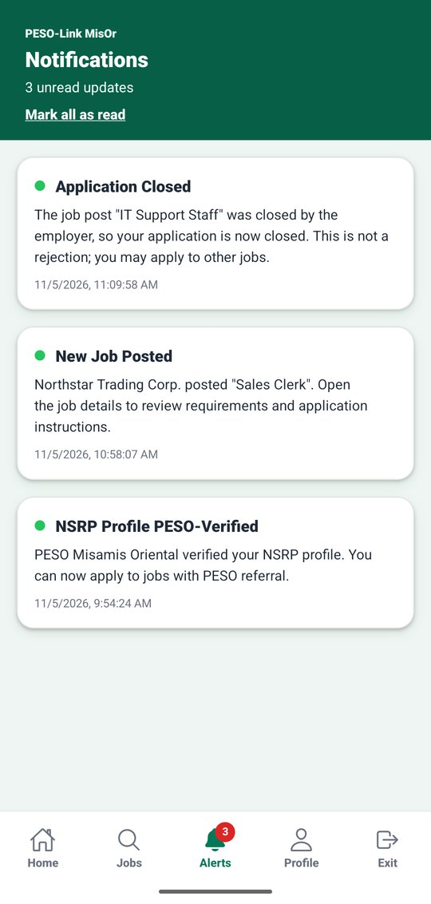

The **Alerts** tab lists updates such as PESO's review of your profile, new job posts, changes to jobs you applied to, and status changes. Tap **Mark all as read** to clear the red number.

[Next: Employer guide](3-employer.md)
