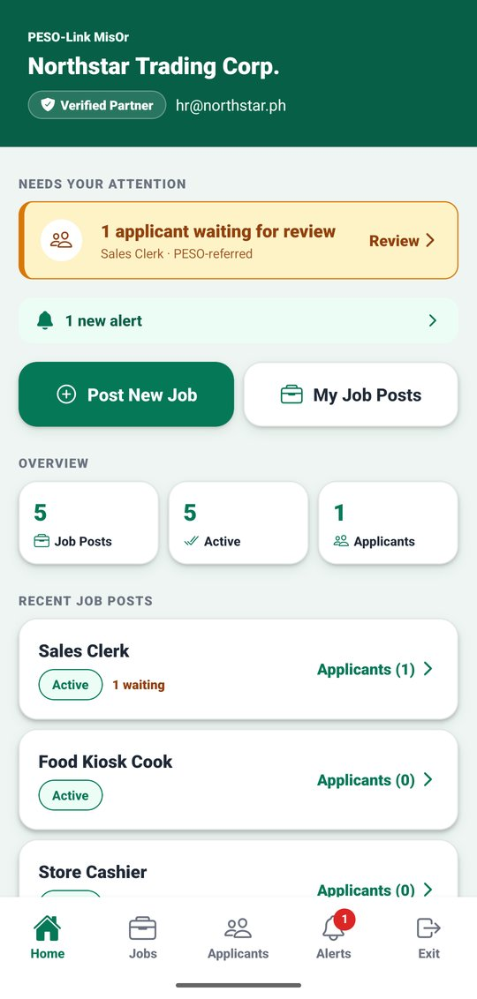
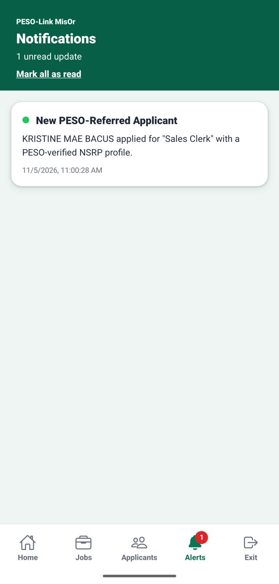
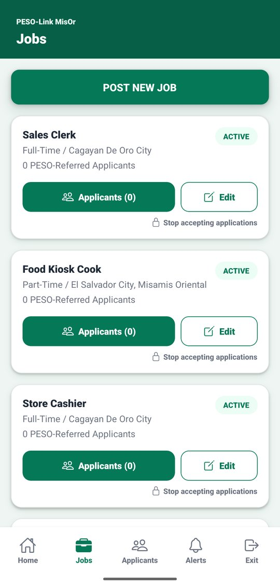
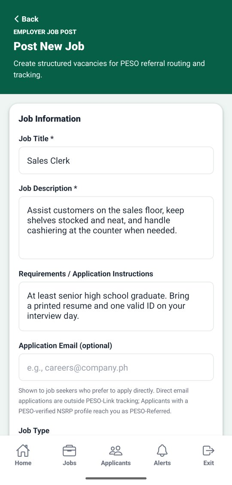
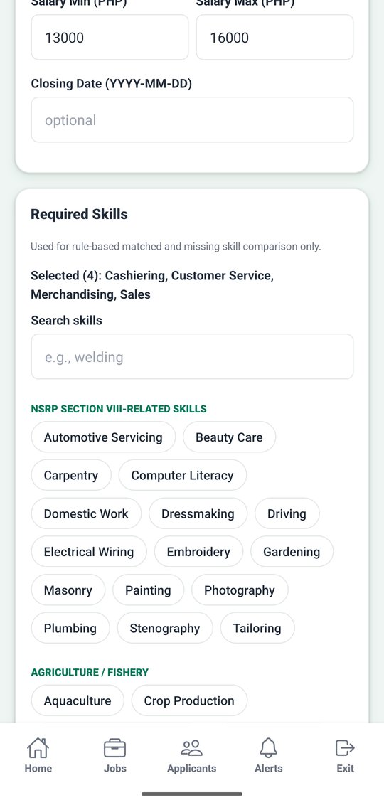
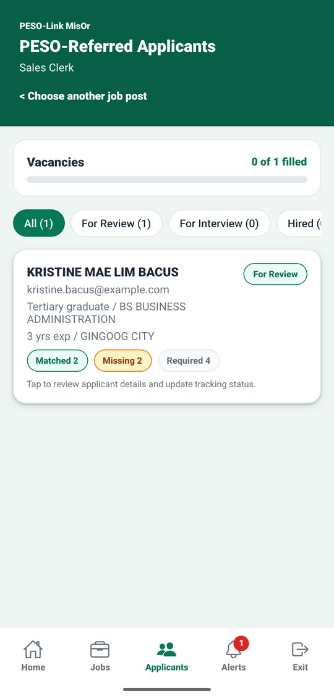
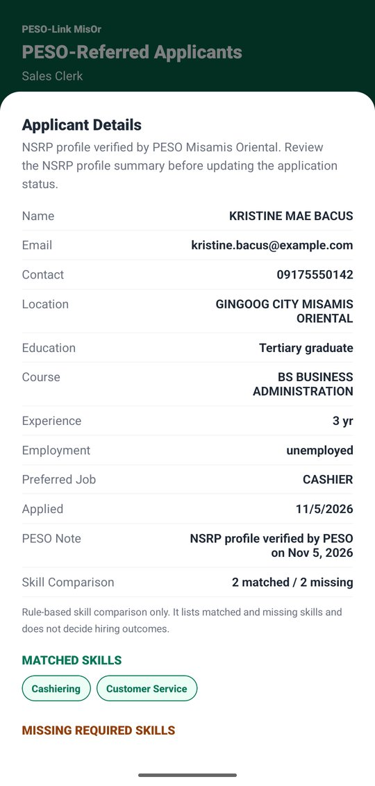
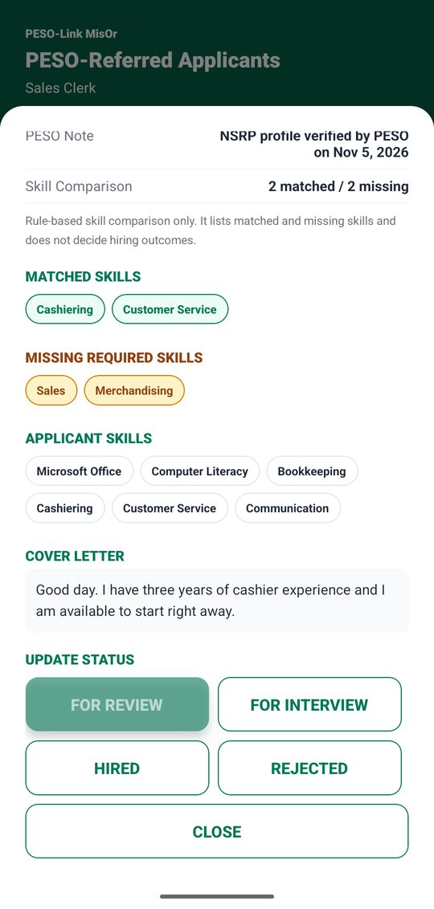
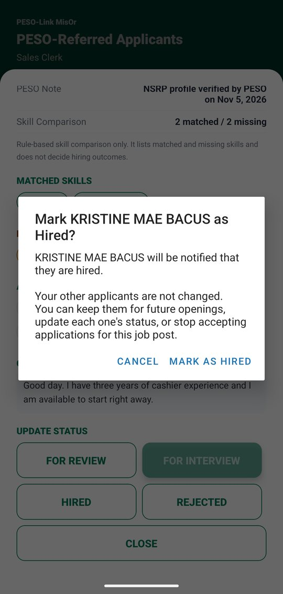
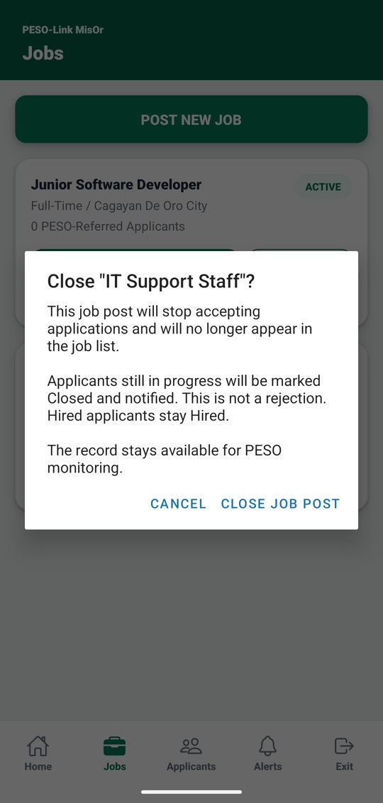

# 3. Employer guide

[Back to contents](README.md)

Employer accounts are created by PESO Admin after PESO approves the employer's requirements outside the app. Sign in on the **Employer** tab (see [Getting started](1-getting-started.md#12-sign-in)).

## 3.1 Home and alerts

 

- **Home** shows applicants waiting for your review, new alerts, **Post New Job**, **My Job Posts**, a short overview, and your recent job posts. You can also view your **Company Profile** here.
- **Alerts** tells you, for example, when a new PESO-referred applicant applies or when all vacancies of a job are filled. Tap **Mark all as read** to clear the red number.

## 3.2 Post a job

  

1. Tap the **Jobs** tab, then **POST NEW JOB**.
2. Fill in the **Job Title**, **Job Description**, **Requirements / Application Instructions** (for example, documents to bring), and optionally an **Application Email** for applicants who prefer to apply directly.
3. Choose the **Job Type**. Then fill in:
   - **Location** and the number of **Vacancies**
   - **Salary Min** and **Salary Max**, numbers only (for example 13000)
   - **Closing Date** (optional), written as YYYY-MM-DD (for example 2026-12-31). Leave it empty if there is none.
4. Under **Required Skills**, choose the skills the job needs:
   - **Found in your text** lists skill names that appear in your description or requirements. Tap one to add it, or **Add all**. Nothing is added until you tap.
   - Use **Search skills** to find others. **Selected (N)** shows what you chose.
5. Scroll to the bottom and tap **POST JOB**. The job appears in the job seekers' job list right away, and they get a "New Job Posted" alert.

The required skills are used only to show each applicant's matched and missing skills. They do not rank applicants or decide anything.

To change a job, tap **Edit** under it in the **Jobs** tab. Applicants of that job get an alert when you change it.

## 3.3 Review PESO-referred applicants

 

1. Tap the **Applicants** tab (or **Applicants** under a job) and choose a job post. To switch to another job, tap **< Choose another job post** at the top.
2. The list shows only **PESO-referred** applicants (job seekers whose NSRP profile PESO verified), with their **Matched**, **Missing**, and **Required** skill counts. Use the status filters at the top.
3. Tap an applicant to see their details: contact, location, education, experience, preferred job, the PESO note, the skill comparison, their skills, and their cover letter.

If the applicant changed their profile after PESO verified it, the details show **"Changed after PESO verification. Not yet re-verified by PESO."**

## 3.4 Update an application's status

 

1. In the applicant details, scroll to **UPDATE STATUS**.
2. Tap **FOR REVIEW**, **FOR INTERVIEW**, **HIRED**, or **REJECTED**.
3. **Hired** and **Rejected** ask you to confirm first and explain what changes. Marking one applicant as hired does not change your other applicants.

The applicant gets an alert and sees the new status in their application history.

When the last vacancy of a job is filled, you get an "All Vacancies Filled" alert, and the waiting applicants get a "Vacancies Filled" alert. Nobody's status changes, so you can keep them for future openings.

## 3.5 Stop accepting applications

1. In the **Jobs** tab, tap **Stop accepting applications** under the job.
2. Read the explanation and tap **CLOSE JOB POST**.

- The job no longer appears in the job list.
- Applicants still in progress are marked **Closed** and notified. **This is not a rejection.** Hired applicants stay Hired.
- The record stays available for PESO monitoring. A closed job post cannot be reopened; post a new one instead.

[Next: PESO Admin guide](4-peso-admin.md)
