# 4. PESO Admin guide

[Back to contents](README.md)

Sign in on the **Admin** tab (see [Getting started](1-getting-started.md#12-sign-in)).

## 4.1 Home

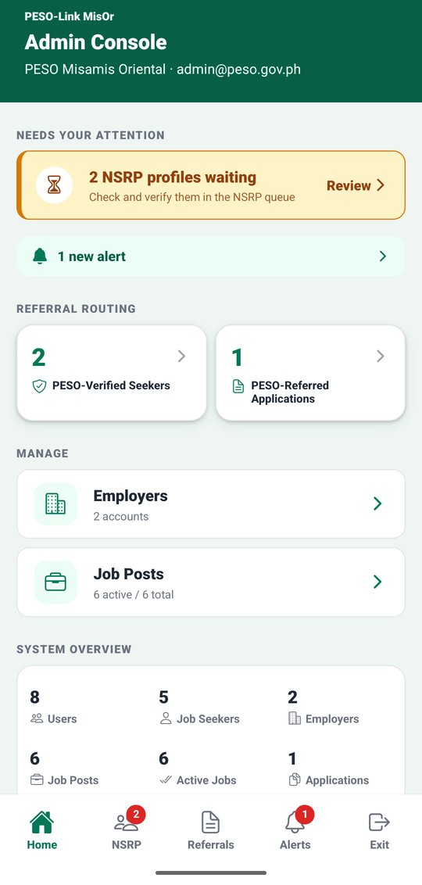

**Home** (Admin Console) shows:
- **Needs Your Attention**: NSRP profiles waiting for review, with a **Review** link
- the number of new alerts
- **Referral Routing**: PESO-Verified job seekers and PESO-Referred applications
- **Manage**: **Employers** and **Job Posts**
- a **System Overview** with counts

## 4.2 Review NSRP profiles

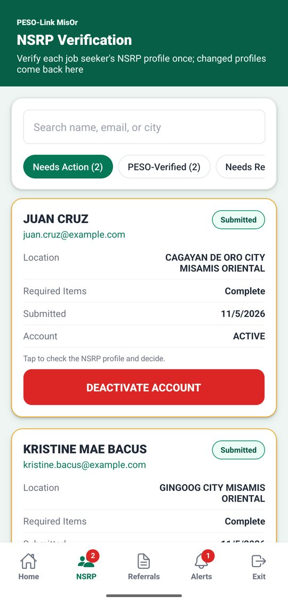 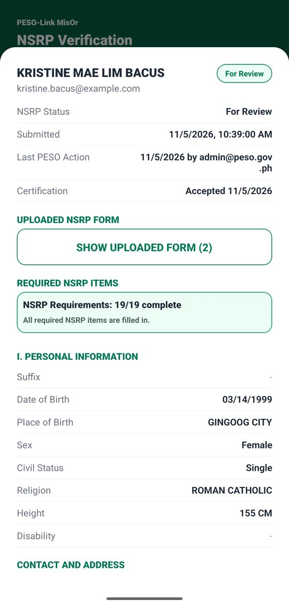 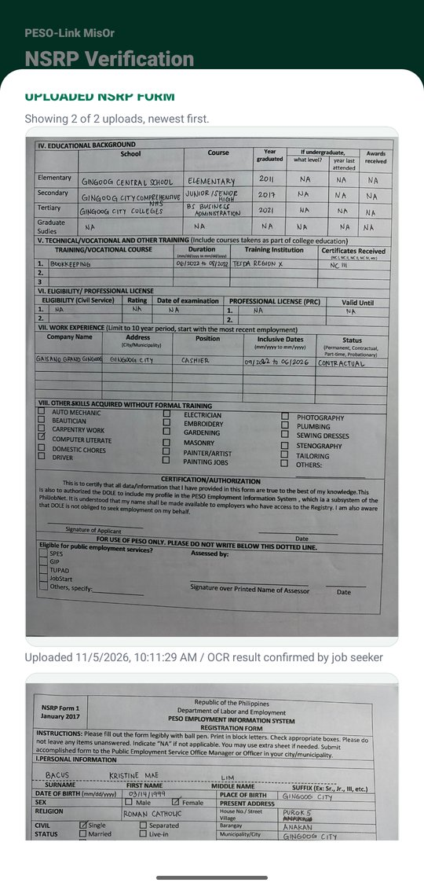

1. Tap the **NSRP** tab. **Needs Action** lists the profiles waiting for PESO. You can search by name, email, or city, and switch to **PESO-Verified**, **Needs Revision**, **Not Submitted**, or **All**.
2. Tap a profile. Opening a submitted profile marks it **For Review**, and the job seeker gets an alert.
3. Check the profile: the submission and certification dates, the **Required NSRP Items** check, and every section of the form.
4. If the job seeker scanned their paper form, tap **SHOW UPLOADED FORM** to see the photos and compare them with the encoded answers.

### Verify, or return for revision

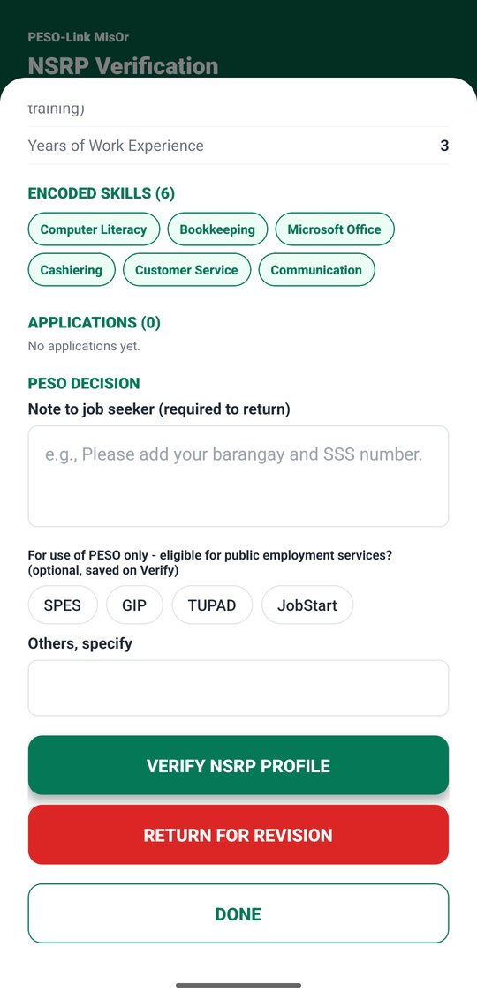 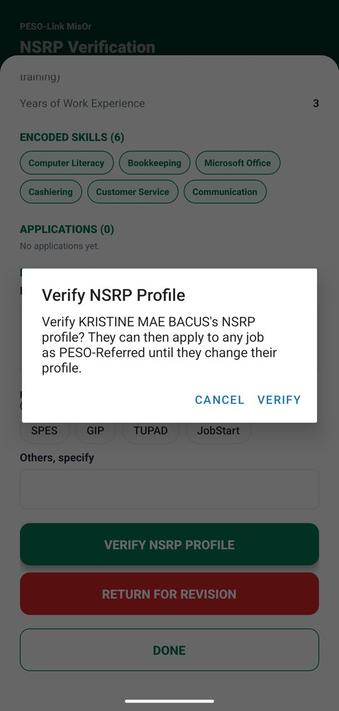 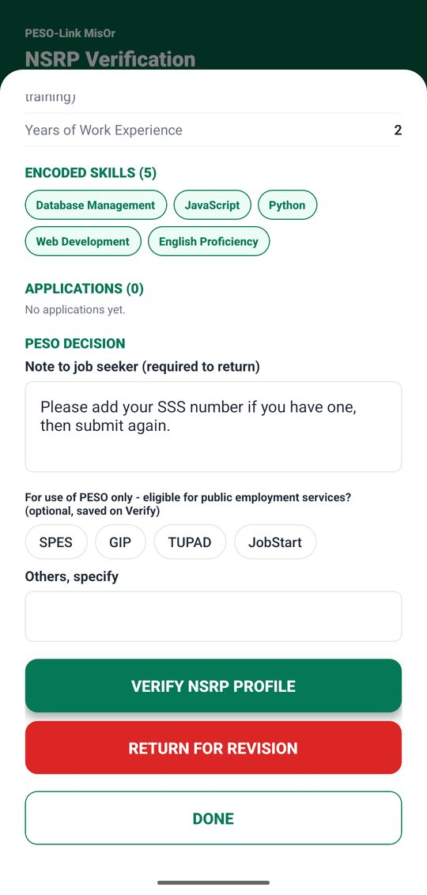

1. Scroll to **PESO DECISION**.
2. Optionally tick the form's "For use of PESO only" programs (**SPES**, **GIP**, **TUPAD**, **JobStart**, or **Others**). They are saved when you verify.
3. Choose one:
   - **VERIFY NSRP PROFILE**, then **VERIFY**: the profile becomes **PESO-Verified**. The job seeker can now apply to any job with PESO referral.
   - **RETURN FOR REVISION**, then **RETURN**: type a **Note to job seeker** first (it is required). The profile becomes **Needs Revision**, and the job seeker sees your note.
4. Tap **DONE** to close the profile.

- Verify is refused if required items are missing; the app lists them.
- If the job seeker changes the profile while you have it open, Verify and Return are refused with "This profile changed since you opened it. Reload and review again."
- A verified job seeker who later changes their profile comes back to **Needs Action** for re-checking.

## 4.3 Monitor PESO-referred applications

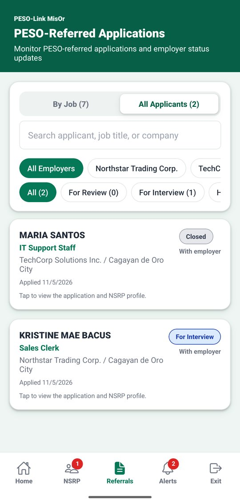 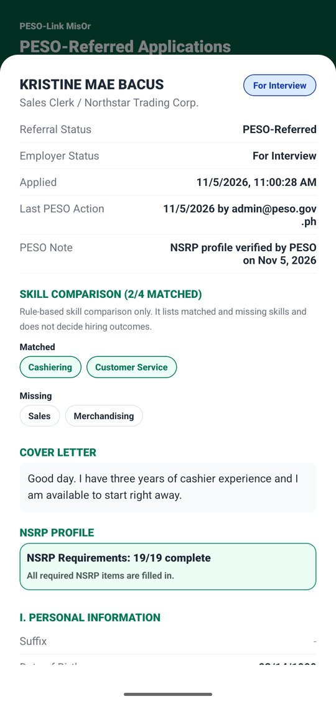

1. Tap the **Referrals** tab.
2. View the applications **By Job** or as **All Applicants**. Search, and filter by employer or status.
3. Tap a record to see the employer's status, the PESO note, the skill comparison, the cover letter, and the job seeker's NSRP profile.

## 4.4 Manage employer accounts

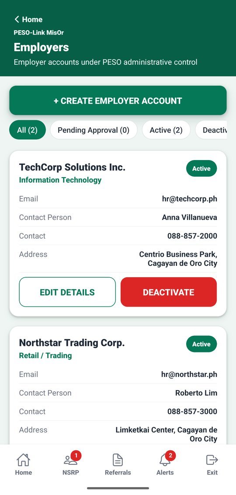 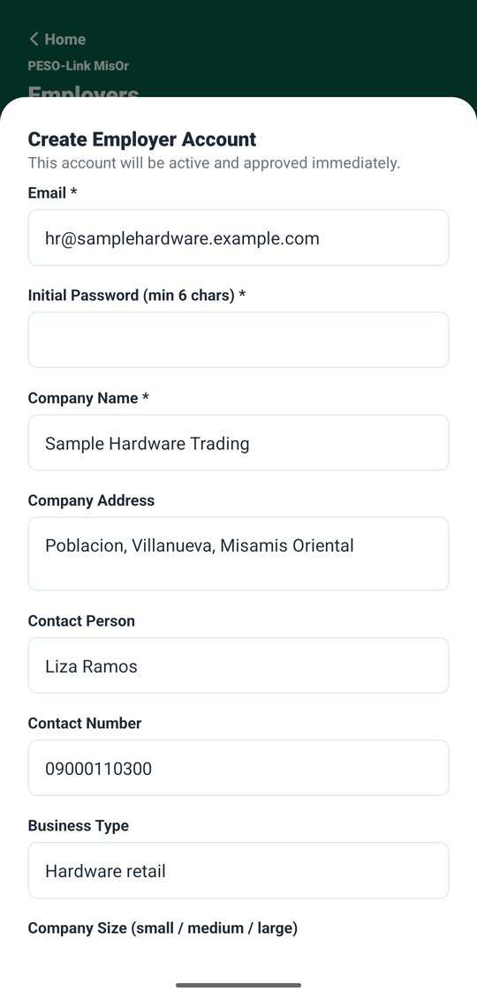

1. On **Home**, tap **Employers**.
2. To add an employer approved by PESO, tap **+ CREATE EMPLOYER ACCOUNT**, fill in the email, initial password, and company details, and tap **Create Account**. The account is active and approved right away. Give the login details to the employer privately.
3. Use **EDIT DETAILS** to change company details.
4. **DEACTIVATE** blocks the employer's sign-in, closes their active job posts, and notifies the affected applicants. Use the **Deactivated** filter to find the account and **Reactivate** it later. Job posts that were closed during the deactivation stay closed.

## 4.5 Job seeker accounts

On the **NSRP** tab, each job seeker card has **DEACTIVATE ACCOUNT**. Deactivating blocks the sign-in and closes the job seeker's in-progress applications (the employers are notified). Under the **All** filter, a deactivated job seeker shows **SUSPENDED** with a **Reactivate** button. A deactivated profile cannot be verified or returned until it is reactivated.

## 4.6 Monitor job posts

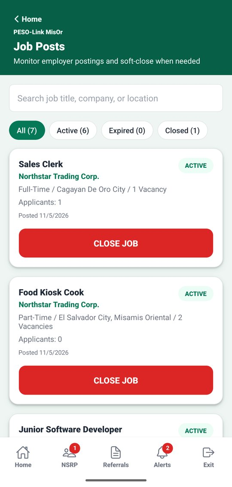 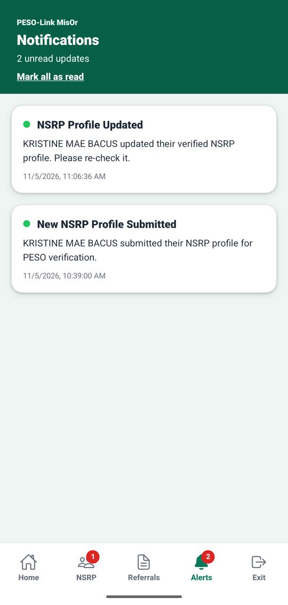

1. On **Home**, tap **Job Posts**. Search, and filter by **Active**, **Expired**, or **Closed**.
2. If needed, tap **CLOSE JOB** to close a post. The employer is notified, and applicants still in progress are marked Closed (not a rejection).

The **Alerts** tab shows PESO Admin alerts, such as new, resubmitted, or changed NSRP profiles.

[Next: Tips and common questions](5-tips-and-faq.md)
